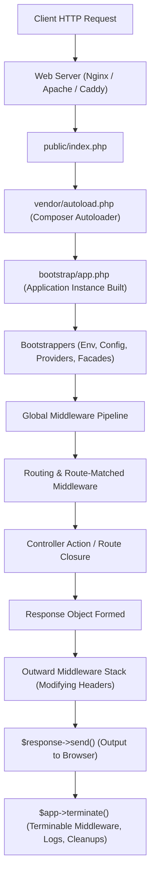
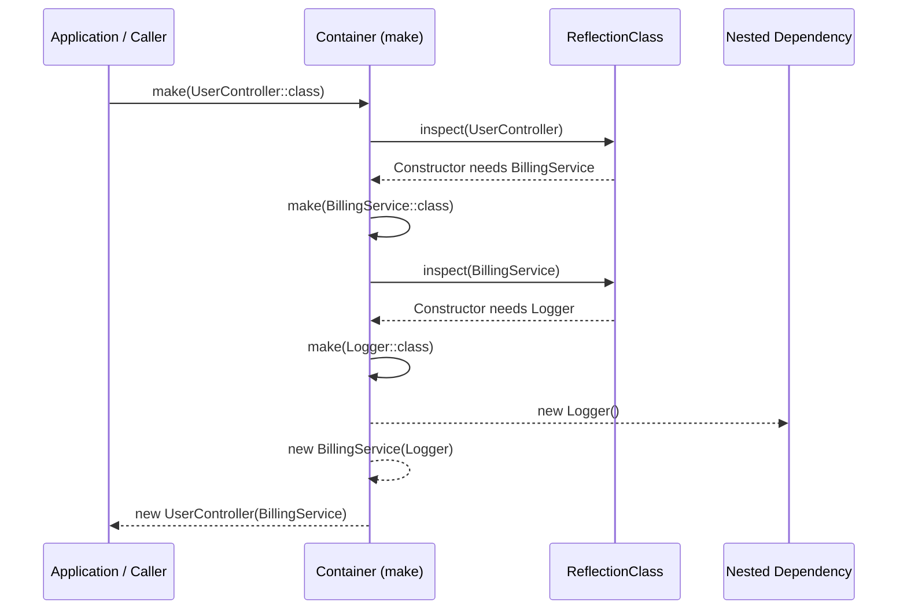
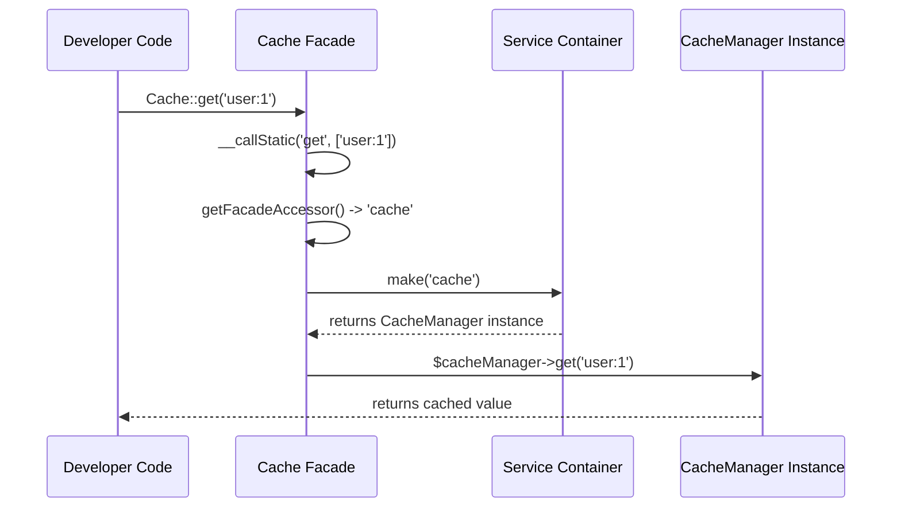
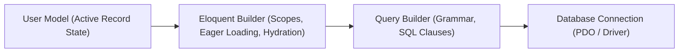

# The Definitive Guide to Laravel Framework Internals

> **Architecture Target**: Modern Laravel architecture (11+). Where core internal patterns evolved from earlier framework iterations, historical context is explicitly provided.
> 
> **Goal**: Demystify Laravel's "magic". By the end of this guide, you will understand how Laravel works line-by-line under the hood, how all its internal components talk to each other, and how to read the framework's source code with confidence.

---

## Table of Contents

1. [Mental Models: Deconstructing the "Magic"](#1-mental-models-deconstructing-the-magic)
2. [The Request Lifecycle: The Complete Journey](#2-the-request-lifecycle-the-complete-journey)
   - [2.1 The Entry Point: `public/index.php`](#21-the-entry-point-publicindexphp)
   - [2.2 Modern Application Bootstrapping (`bootstrap/app.php`)](#22-modern-application-bootstrapping-bootstrapappphp)
   - [2.3 The Bootstrapping Sequence (`Application::bootstrapWith`)](#23-the-bootstrapping-sequence-applicationbootstrapwith)
   - [2.4 Response Delivery & The Termination Phase](#24-response-delivery--the-termination-phase)
3. [The Heart: The Service Container (`Illuminate\Container\Container`)](#3-the-heart-the-service-container-illuminatecontainercontainer)
   - [3.1 Internal Data Structures](#31-internal-data-structures)
   - [3.2 Binding Primitives (`bind`, `singleton`, `scoped`, Contextual)](#32-binding-primitives-bind-singleton-scoped-contextual)
   - [3.3 Zero-Configuration Resolution & PHP Reflection API](#33-zero-configuration-resolution--php-reflection-api)
   - [3.4 Container Hooks & Lifecycles](#34-container-hooks--lifecycles)
4. [The Pipeline Pattern & Middleware Architecture](#4-the-pipeline-pattern--middleware-architecture)
   - [4.1 The Onion Concept](#41-the-onion-concept)
   - [4.2 The Engine: `Illuminate\Pipeline\Pipeline` and `array_reduce`](#42-the-engine-illuminatepipelinepipeline-and-array_reduce)
   - [4.3 Before, After, and Terminable Middleware](#43-before-after-and-terminable-middleware)
5. [The Routing Engine & Controller Dispatcher](#5-the-routing-engine--controller-dispatcher)
   - [5.1 Route Collection & Symfony Regex Compilation](#51-route-collection--symfony-regex-compilation)
   - [5.2 Route Model Binding Under the Hood](#52-route-model-binding-under-the-hood)
   - [5.3 Controller Dispatching & Parameter Injection](#53-controller-dispatching--parameter-injection)
6. [Facades Decoded: How Static Calls Become Real Objects](#6-facades-decoded-how-static-calls-become-real-objects)
   - [6.1 The Mechanics: `__callStatic()` and the Container](#61-the-mechanics-__callstatic-and-the-container)
   - [6.2 Real-Time Facades (In-Memory `eval()` Generation)](#62-real-time-facades-in-memory-eval-generation)
   - [6.3 How Facades Support Mocking](#63-how-facades-support-mocking)
7. [Database & Eloquent ORM Internals](#7-database--eloquent-orm-internals)
   - [7.1 The Four-Tier Architecture: Model, Eloquent Builder, Query Builder, PDO](#71-the-four-tier-architecture-model-eloquent-builder-query-builder-pdo)
   - [7.2 Attribute Storage, Dirty Checking & Magic Accessors](#72-attribute-storage-dirty-checking--magic-accessors)
   - [7.3 The Hydration Pipeline](#73-the-hydration-pipeline)
   - [7.4 Relationships & Eager Loading (N+1 Elimination)](#74-relationships--eager-loading-n1-elimination)
   - [7.5 Model Booting & Global Scopes](#75-model-booting--global-scopes)
8. [Events & Queue System Internals](#8-events--queue-system-internals)
   - [8.1 Event Dispatcher & Listener Auto-Discovery](#81-event-dispatcher--listener-auto-discovery)
   - [8.2 Queue Job Serialization & `SerializesModels`](#82-queue-job-serialization--serializesmodels)
   - [8.3 The Worker Daemon Loop (`queue:work`)](#83-the-worker-daemon-loop-queuework)
9. [Application Runtimes: PHP-FPM vs Long-Running Runtimes (Octane)](#9-application-runtimes-php-fpm-vs-long-running-runtimes-octane)
   - [9.1 Stateless PHP-FPM vs Persistent Memory Runtimes](#91-stateless-php-fpm-vs-persistent-memory-runtimes)
   - [9.2 The Container Sandbox & State Resets](#92-the-container-sandbox--state-resets)
10. [Summary: The 10 Architectural Principles to Remember](#10-summary-the-10-architectural-principles-to-remember)

---

## 1. Mental Models: Deconstructing the "Magic"

Many developers look at Laravel syntax and call it "magic":
```php
// How can this static method query a database, instantiate objects, and return a collection?
$users = User::where('active', 1)->orderBy('name')->get();

// How does Laravel know what to pass here without any configuration?
public function update(Request $request, UserRepository $users, int $id) { ... }
```

In reality, **there is zero magic in Laravel**. Everything is built on 5 core PHP primitives:
1. **PHP Magic Methods**: `__get()`, `__set()`, `__call()`, `__callStatic()`, `__invoke()`.
2. **PHP Reflection API**: `ReflectionClass`, `ReflectionMethod`, `ReflectionParameter` to inspect code at runtime.
3. **Closures (Anonymous Functions)**: Passing executable logic through pipelines and container factories.
4. **The Service Container**: A centralized in-memory registry map that holds bindings and singletons.
5. **Array Iteration (`array_reduce`)**: Wrapping layers of logic around each other like an onion.

Whenever you see something "magical" in Laravel, it is simply one of these five mechanics at work.

---

## 2. The Request Lifecycle: The Complete Journey

Here is the high-level path an incoming HTTP request travels through Laravel:



---

### 2.1 The Entry Point: `public/index.php`

Every single web request hits `public/index.php`. Look at what this file actually contains:

```php
use Illuminate\Http\Request;

define('LARAVEL_START', microtime(true));

// 1. Check if the application is in maintenance mode
if (file_exists($maintenance = __DIR__.'/../storage/framework/maintenance.php')) {
    require $maintenance;
}

// 2. Register the Composer Autoloader
require __DIR__.'/../vendor/autoload.php';

// 3. Bootstrap the Laravel Application
$app = require_once __DIR__.'/../bootstrap/app.php';

// 4. Capture the Incoming Request and Handle It
$app->handleRequest(Request::capture());
```

Notice how lean the front controller is:
- `Request::capture()`: Grabs PHP superglobals (`$_GET`, `$_POST`, `$_SERVER`, `$_FILES`, `$_COOKIE`) and wraps them inside an `Illuminate\Http\Request` instance (which extends Symfony's `HttpFoundation\Request`).
- `$app->handleRequest(...)`: Runs the request through the middleware and router, sends the response back to the client, and immediately triggers termination.

---

### 2.2 Modern Application Bootstrapping (`bootstrap/app.php`)

In modern Laravel architecture, application configuration and bootstrapping are unified cleanly using the **fluent Application Builder** pattern in `bootstrap/app.php`:

```php
use Illuminate\Foundation\Application;
use Illuminate\Foundation\Configuration\Exceptions;
use Illuminate\Foundation\Configuration\Middleware;

return Application::configure(basePath: dirname(__DIR__))
    ->withRouting(
        web: __DIR__.'/../routes/web.php',
        api: __DIR__.'/../routes/api.php',
        commands: __DIR__.'/../routes/console.php',
        health: '/up',
    )
    ->withMiddleware(function (Middleware $middleware) {
        // Configure global, web, or api middleware
        $middleware->web(append: [
            \App\Http\Middleware\MyCustomMiddleware::class,
        ]);
    })
    ->withExceptions(function (Exceptions $exceptions) {
        // Custom exception reporting and rendering
    })->create();
```

> **Historical Context**: In earlier Laravel versions, this setup was split across multiple files: `app/Http/Kernel.php`, `app/Console/Kernel.php`, and dedicated providers like `RouteServiceProvider`. Modern Laravel consolidates this registration into `ApplicationBuilder`, which delegates to the exact same underlying framework mechanisms.

#### Under the Hood: `Application::configure()`
Under the hood, `Application::configure()` creates an instance of `Illuminate\Foundation\Configuration\ApplicationBuilder`.
When you call `->create()`, the builder:
1. Instantiates `Illuminate\Foundation\Application` (which is the Service Container itself).
2. Sets the base application paths (`app`, `config`, `storage`, `public`, `database`).
3. Registers core framework Service Providers (Event, Log, Routing).
4. Prepares routing paths, middleware stacks, and exception handling definitions.

---

### 2.3 The Bootstrapping Sequence (`Application::bootstrapWith`)

Before any route can be matched or controller executed, the application instance runs its core **Bootstrappers**.
In modern Laravel, `ApplicationBuilder` passes the core bootstrapper list to `Application::bootstrapWith($bootstrappers)`:

```php
protected $bootstrappers = [
    \Illuminate\Foundation\Bootstrap\LoadEnvironmentVariables::class,
    \Illuminate\Foundation\Bootstrap\LoadConfiguration::class,
    \Illuminate\Foundation\Bootstrap\HandleExceptions::class,
    \Illuminate\Foundation\Bootstrap\RegisterFacades::class,
    \Illuminate\Foundation\Bootstrap\RegisterProviders::class,
    \Illuminate\Foundation\Bootstrap\BootProviders::class,
];
```

Let's trace what each bootstrapper does internally:

1. **`LoadEnvironmentVariables`**: Uses `vlucas/phpdotenv` to parse the `.env` file into PHP's `$_ENV` and `getenv()`.
2. **`LoadConfiguration`**: Scans all files in `config/*.php`. It parses them into a single in-memory `Illuminate\Config\Repository` repository object. If `bootstrap/cache/config.php` exists (from `php artisan config:cache`), it loads that single compiled array instantly, bypassing the filesystem scan.
3. **`HandleExceptions`**: Converts PHP notices, warnings, and unhandled exceptions into Laravel's exception handling engine (`Illuminate\Foundation\Exceptions\Handler`).
4. **`RegisterFacades`**: Initializes `Illuminate\Support\Facades\Facade::setFacadeApplication($app)` and configures alias auto-loading.
5. **`RegisterProviders`**: Iterates through registered Service Providers and executes their `register()` methods.
6. **`BootProviders`**: Once **all** providers have registered, it iterates through them again and executes their `boot()` methods.

> **Crucial Rule**:
> - In `register()`: **Only bind services into the container**. Never invoke or depend on other services, because they might not have registered yet.
> - In `boot()`: All services are registered. It is now safe to resolve dependencies, register route macros, model observers, or event listeners.

---

### 2.4 Response Delivery & The Termination Phase

Once your controller returns data:
1. Laravel transforms it into an `Illuminate\Http\Response` (strings, arrays converted to JSON, view templates compiled to HTML).
2. The response travels back out through the middleware stack.
3. `$response->send()` flushes the HTTP headers and echoes the response body to PHP's output buffer (the user sees the page).
4. `$app->terminate()` executes:
   - Any middleware implementing `TerminableMiddleware` has its `terminate($request, $response)` method executed. This runs **after** the client has already received the response (ideal for logging, metrics, or background cleanup).
   - Container termination callbacks run.

---

## 3. The Heart: The Service Container (`Illuminate\Container\Container`)

The Service Container is the heart of Laravel.
In fact, the `$app` instance is a direct subclass of `Illuminate\Container\Container`:

```php
class Application extends Container implements ApplicationContract, ...
```

---

### 3.1 Internal Data Structures

The container is fundamentally a collection of PHP arrays managing object lifecycles:

```php
class Container
{
    // Concrete bindings registered via bind() or singleton()
    protected $bindings = [];

    // Shared singleton instances already resolved and cached
    protected $instances = [];

    // Class aliases (e.g., 'db' => 'Illuminate\Database\DatabaseManager')
    protected $aliases = [];

    // Tracks which classes have been resolved at least once
    protected $resolved = [];

    // Contextual bindings: [ClassA => [InterfaceB => ImplementationC]]
    public $contextual = [];

    // Stack of classes currently being built (detects circular dependencies)
    protected $buildStack = [];
}
```

---

### 3.2 Binding Primitives (`bind`, `singleton`, `scoped`, Contextual)

#### 1. Basic Binding (`bind`)
Creates a new instance **every time** it is requested.
```php
$app->bind(TranslatableInterface::class, GoogleTranslator::class);
```
Internally stored in `$bindings`:
```php
$this->bindings[TranslatableInterface::class] = [
    'concrete' => Closure (returns new GoogleTranslator),
    'shared'   => false, // Not a singleton
];
```

#### 2. Singleton (`singleton`)
Resolves the instance **once** on first request, saves it in `$instances`, and returns that exact same instance on every subsequent call.
```php
$app->singleton(DatabaseConnection::class, function ($app) {
    return new DatabaseConnection($app['config']['db']);
});
```
On first resolution:
1. Concrete closure executes.
2. The result is stored in `$this->instances[DatabaseConnection::class]`.
3. Subsequent resolutions bypass the factory closure and return directly from `$instances`.

#### 3. Scoped Binding (`scoped`)
Acts like a singleton within the current lifecycle (e.g. single HTTP request or queue job), but is cleared when the request ends. In persistent runtimes like Laravel Octane, scoped instances are automatically flushed between requests, while standard singletons persist.

#### 4. Contextual Binding (`when()->needs()->give()`)
Allows injecting different implementations of an interface depending on which class requests it:
```php
$app->when(OrderController::class)
    ->needs(PaymentGateway::class)
    ->give(StripeGateway::class);

$app->when(SubscriptionController::class)
    ->needs(PaymentGateway::class)
    ->give(PaypalGateway::class);
```
Under the hood, Laravel stores this in `$this->contextual[OrderController::class][PaymentGateway::class] = StripeGateway::class`.

---

### 3.3 Zero-Configuration Resolution & PHP Reflection API

You rarely need to bind classes manually because Laravel has **Auto-Wiring**.
When you type-hint a class in a controller:
```php
class UserController {
    public function __construct(BillingService $billing) { ... }
}
```
How does Laravel know how to instantiate `BillingService`?
It uses PHP's **Reflection API** (`ReflectionClass`, `ReflectionMethod`).

Here is a simplified version of the container's core `build()` algorithm:

```php
public function build($concrete)
{
    // 1. If it's a closure, execute it directly
    if ($concrete instanceof Closure) {
        return $concrete($this);
    }

    // 2. Reflect on the class
    $reflector = new ReflectionClass($concrete);

    // 3. Is the class instantiable? (Interfaces and abstract classes are not)
    if (! $reflector->isInstantiable()) {
        throw new BindingResolutionException("Target [$concrete] is not instantiable.");
    }

    // 4. Inspect the constructor
    $constructor = $reflector->getConstructor();

    // If there is no constructor, just new it up!
    if (is_null($constructor)) {
        return new $concrete;
    }

    // 5. Inspect constructor parameters
    $dependencies = $constructor->getParameters();
    $instances = [];

    foreach ($dependencies as $parameter) {
        $type = $parameter->getType();

        // If it's a primitive type (int, string), look for contextual default
        if (! $type || $type->isBuiltin()) {
            if ($parameter->isDefaultValueAvailable()) {
                $instances[] = $parameter->getDefaultValue();
            } else {
                throw new BindingResolutionException("Cannot resolve primitive parameter.");
            }
        } else {
            // It's a class type-hint! Recursively resolve it from the container!
            $className = $type->getName();
            $instances[] = $this->make($className); // <--- Recursion
        }
    }

    // 6. Instantiate the class with resolved dependencies
    return $reflector->newInstanceArgs($instances);
}
```



#### Circular Dependency Protection
What if Class A requires Class B, and Class B requires Class A?
Laravel pushes each class name onto `$this->buildStack` before resolving. If a class name already exists in `$buildStack`, Laravel throws a `CircularDependencyException`.

---

### 3.4 Container Hooks & Lifecycles

Laravel lets you hook into object resolution:
```php
// Fired when the class is being resolved
$app->resolving(PaymentGateway::class, function ($gateway, $app) {
    $gateway->setApiKey($app['config']['stripe.key']);
});

// Fired after the class is fully built
$app->afterResolving(function ($object) {
    // Audit or inspect resolved objects
});
```

---

## 4. The Pipeline Pattern & Middleware Architecture

Middleware act as security gates, data transformers, and sanitizers.
Laravel implements this using the **Pipeline Pattern**.

---

### 4.1 The Onion Concept

Think of an HTTP request entering an onion:
```
           Incoming Request
                  │
                  ▼
         ┌───────────────────┐
         │ Global Middleware │  (TrimStrings, MaintenanceMode)
         │   ┌─────────────┐ │
         │   │ Route Group │ │  (EncryptCookies, StartSession, VerifyCsrf)
         │   │   ┌───────┐ │ │
         │   │   │ Route │ │ │  (Auth, Throttle)
         │   │   │   │   │ │ │
         │   │   │   ▼   │ │ │
         │   │   │ [App] │ │ │  (Controller Action)
         │   │   │   │   │ │ │
         │   │   │   ▼   │ │ │
         │   │   │Response││ │
         │   │   └───────┘ │ │
         │   └─────────────┘ │
         └───────────────────┘
                  │
                  ▼
           Sent to Client
```

---

### 4.2 The Engine: `Illuminate\Pipeline\Pipeline` and `array_reduce`

How does Laravel nest these closures without deeply nesting functions manually?
The secret is `Illuminate\Pipeline\Pipeline` powered by PHP's `array_reduce()`.

Here is the exact conceptual core of Laravel's `Pipeline`:

```php
public function then(Closure $destination)
{
    // $pipes contains all middleware classes: [VerifyCsrf::class, Authenticate::class]
    $pipeline = array_reduce(
        array_reverse($this->pipes),
        $this->carry(),
        $this->prepareDestination($destination)
    );

    return $pipeline($this->passable); // $passable is the $request
}

protected function carry()
{
    return function ($stack, $pipe) {
        return function ($passable) use ($stack, $pipe) {
            // $stack is the next inner layer
            // $pipe is the current middleware
            return $pipe->handle($passable, $stack);
        };
    };
}
```

#### Why `array_reverse`?
Because `array_reduce` folds an array from left to right.
By reversing the middleware array, the **innermost** layer (the Controller) is wrapped by the last middleware, which is wrapped by the second-to-last, until the **first** middleware sits on the very outside.

When you call `$next($request)` in your middleware:
```php
public function handle($request, Closure $next)
{
    // Code here runs on the WAY IN
    $response = $next($request); // <--- Hands off to the next inner layer!
    // Code here runs on the WAY OUT
    return $response;
}
```

---

### 4.3 Before, After, and Terminable Middleware

- **Before Middleware**: Executes code before calling `$next($request)` (e.g. `Authenticate`).
- **After Middleware**: Calls `$next($request)` first, then modifies the resulting `$response` (e.g. adding security headers like `Content-Security-Policy`).
- **Terminable Middleware**: Defines a `terminate($request, $response)` method. Executed after `fastcgi_finish_request()` has flushed bytes to the browser.

---

## 5. The Routing Engine & Controller Dispatcher

Routing connects an HTTP method + URI to executable logic.

---

### 5.1 Route Collection & Symfony Regex Compilation

When you define a route:
```php
Route::get('/users/{id}', [UserController::class, 'show']);
```
1. Laravel creates an `Illuminate\Routing\Route` object.
2. It registers it in the `Illuminate\Routing\RouteCollection`.
3. Under the hood, Laravel compiles routes into optimized regular expressions using Symfony's `CompiledRoute`.
   - `/users/{id}` becomes regular expression: `#^/users/(?P<id>[^/]++)$#sDu`

When an incoming request matches the regex, the route parameters (`id = 42`) are extracted into the Route's parameter bag.

---

### 5.2 Route Model Binding Under the Hood

When you type-hint a model in a route or controller:
```php
Route::get('/users/{user}', function (User $user) {
    return $user;
});
```

How does `{user}` get converted to a database model?
1. The `SubstituteBindings` middleware runs.
2. It inspects the route's parameters and compares them to the action's method signature.
3. For each parameter matching a type-hinted Eloquent model:
   - It calls `resolveRouteBinding($value)` on the Model class.
   - Which runs: `User::where($model->getRouteKeyName(), $value)->firstOrFail()`.
4. If the record is found, it replaces the raw parameter string (`"42"`) with the hydrated `User` model instance.

---

### 5.3 Controller Dispatching & Parameter Injection

Once matched, the route is passed to `Illuminate\Routing\ControllerDispatcher`:

```php
public function dispatch(Route $route, $controller, $method)
{
    $parameters = $this->resolveParameters($route, $controller, $method);

    return $controller->{$method}(...$parameters);
}
```

The `resolveParameters()` method combines:
1. **Container Auto-wiring**: Type-hinted services (e.g. `Request`, `Mailer`).
2. **Route Parameters**: URL variables (e.g. `id`, `slug`).

It merges them in the exact order declared by your controller method signature.

---

## 6. Facades Decoded: How Static Calls Become Real Objects

Facades provide a clean, memorable syntax for services in the container:
```php
Cache::get('key');
// Is secretly identical to:
app('cache')->get('key');
```

---

### 6.1 The Mechanics: `__callStatic()` and the Container

Look at the `Cache` facade:
```php
class Cache extends Facade
{
    protected static function getFacadeAccessor()
    {
        return 'cache';
    }
}
```

There is no static `get()` method on `Cache`!
When you invoke `Cache::get('key')`, PHP executes `Facade::__callStatic()`:

```php
abstract class Facade
{
    protected static $resolvedInstance = [];
    protected static $app;

    public static function __callStatic($method, $args)
    {
        // 1. Get the underlying instance from the container
        $instance = static::getFacadeRoot();

        if (! $instance) {
            throw new RuntimeException('A facade root has not been set.');
        }

        // 2. Call the method on the real object dynamically
        return $instance->$method(...$args);
    }

    public static function getFacadeRoot()
    {
        $name = static::getFacadeAccessor(); // Returns 'cache'

        if (is_object($name)) {
            return $name;
        }

        // Check if we already resolved and cached this instance
        if (isset(static::$resolvedInstance[$name])) {
            return static::$resolvedInstance[$name];
        }

        // Resolve it from the container and cache it
        return static::$resolvedInstance[$name] = static::$app->make($name);
    }
}
```



---

### 6.2 Real-Time Facades (In-Memory `eval()` Generation)

Laravel allows turning any application class into a Facade on demand by prefixing the namespace with `Facades\`:
```php
use Facades\App\Services\PaymentService;

PaymentService::charge(100);
```

How does this work under the hood without pre-generated files?
1. Laravel registers `Illuminate\Foundation\AliasLoader` inside PHP's SPL class autoloader stack (`spl_autoload_register`).
2. When PHP encounters an unresolved class starting with `Facades\`, `AliasLoader::load()` intercepts the request.
3. It parses the target class name (`App\Services\PaymentService`).
4. In memory, it constructs the class definition string:
   ```php
   namespace Facades\App\Services;

   class PaymentService extends \Illuminate\Support\Facades\Facade
   {
       protected static function getFacadeAccessor()
       {
           return 'App\\Services\\PaymentService';
       }
   }
   ```
5. It executes `eval()` on that definition string. The class is registered directly into PHP's runtime memory without reading or writing any files to disk.

---

### 6.3 How Facades Support Mocking

Developers often think Facades make testing impossible. In reality, Facades are 100% testable:
```php
Cache::shouldReceive('get')->with('key')->andReturn('mocked-value');
```
Under the hood:
1. `shouldReceive()` creates a Mockery mock object.
2. It replaces the cached instance in `Facade::$resolvedInstance['cache']`.
3. It binds the mock into the Service Container: `$app->instance('cache', $mock)`.

---

## 7. Database & Eloquent ORM Internals

Eloquent is an implementation of the **Active Record Pattern**, but with an advanced query compilation layer.

---

### 7.1 The Four-Tier Architecture: Model, Eloquent Builder, Query Builder, PDO

When you execute:
```php
User::where('active', 1)->first();
```
Four layers collaborate:



1. **`Illuminate\Database\Eloquent\Model`**: Handles entity state, events, relations, casting, and dirty tracking.
2. **`Illuminate\Database\Eloquent\Builder`**: Handles Eloquent-specific queries (scopes, eager loading with `with()`, model hydration).
3. **`Illuminate\Database\Query\Builder`**: Agnostic SQL query builder (compiles `where`, `join`, `orderBy` using database-specific `Grammar`).
4. **`Illuminate\Database\Connection`**: Manages the underlying PDO instance and PDO prepared statements.

---

### 7.2 Attribute Storage, Dirty Checking & Magic Accessors

An Eloquent model does **not** declare its table columns as PHP class properties.
All database values are stored in an internal array:

```php
class Model
{
    // The current attributes (including edits)
    protected $attributes = [];

    // The raw attributes as loaded from the database
    protected $original = [];

    // Cached attribute mutations and casts
    protected $casts = [];
}
```

#### Magic Getters & Setters (`__get` / `__set`)
When you access `$user->email`:
1. PHP sees that `public $email` does not exist on the class.
2. PHP invokes `Model::__get('email')`.
3. Laravel checks:
   - Is there a custom accessor (`getEmailAttribute` or `Attribute::make()`)?
   - Is there a cast defined in `casts()`?
   - Is there a relationship method named `email()`?
   - Otherwise, return `$this->attributes['email']`.

#### Dirty Checking
When you call `$user->save()`:
```php
public function isDirty($attributes = null)
{
    return ! empty($this->getDirty());
}

public function getDirty()
{
    $dirty = [];
    foreach ($this->attributes as $key => $value) {
        if (! array_key_exists($key, $this->original) || $value !== $this->original[$key]) {
            $dirty[$key] = $value;
        }
    }
    return $dirty;
}
```
Laravel compares `$this->attributes` against `$this->original`.
Only columns that actually changed are compiled into the SQL `UPDATE` statement!

---

### 7.3 The Hydration Pipeline

When a query runs:
```php
$users = User::where('active', 1)->get();
```
1. `Connection` runs the raw PDO query: `$statement->fetchAll(PDO::FETCH_ASSOC)`.
2. This returns an array of plain PHP arrays:
   ```php
   [
       ['id' => 1, 'name' => 'Alice', 'email' => 'alice@test.com'],
       ['id' => 2, 'name' => 'Bob', 'email' => 'bob@test.com'],
   ]
   ```
3. Eloquent takes each raw array and passes it to `User::newFromBuilder($rawRow)`:
   - Creates a new `User` instance without running the standard constructor.
   - Populates both `$attributes` and `$original` with the raw database data.
   - Fires the `retrieved` Eloquent event.
4. Returns an `Illuminate\Database\Eloquent\Collection` of hydrated models.

---

### 7.4 Relationships & Eager Loading (N+1 Elimination)

#### The N+1 Problem
If you query 100 posts and loop over `$post->author->name`, without eager loading Laravel executes:
- 1 query to get 100 posts.
- 100 individual queries to get the author for each post. (101 queries total).

#### How `with('author')` Works Internally:
```php
$posts = Post::with('author')->get();
```
1. Laravel runs the primary query: `SELECT * FROM posts`.
2. It plucks all foreign keys from the results: `$authorIds = [1, 2, 5, 8...]`.
3. It runs **one single query** for the relationship:
   ```sql
   SELECT * FROM authors WHERE id IN (1, 2, 5, 8...);
   ```
4. **Dictionary Matching**: Laravel organizes the loaded `Author` models in an internal array keyed by ID:
   ```php
   $dictionary[1] = Author(1);
   $dictionary[2] = Author(2);
   ```
5. It loops through the `Post` models and matches `$post->setRelation('author', $dictionary[$post->author_id])`.
Total queries: **2**.

---

### 7.5 Model Booting & Global Scopes

Every model boots once per PHP request lifecycle via `Model::booting()` and `Model::boot()`.
Laravel automatically boots any trait on your model that follows the naming convention `boot[TraitName]()`:

```php
// In a trait:
trait SoftDeletes
{
    public static function bootSoftDeletes()
    {
        static::addGlobalScope(new SoftDeletingScope);
    }
}
```
When `User` boots, Laravel reflects on all used traits and automatically executes `bootSoftDeletes()`. This is how features like `SoftDeletes`, `HasUlids`, and `HasUuids` work without manual setup.

---

## 8. Events & Queue System Internals

---

### 8.1 Event Dispatcher & Listener Auto-Discovery

The event system is managed by `Illuminate\Events\Dispatcher`:
```php
class Dispatcher
{
    // Map of events to their listeners
    protected $listeners = [
        OrderPlaced::class => [
            SendOrderConfirmation::class,
            UpdateInventory::class,
        ],
    ];
}
```

In modern Laravel, **Event Discovery** is enabled by default.
Instead of manually registering events in a service provider, Laravel scans the `app/Listeners` directory, inspects the type-hint of each listener's `handle(OrderPlaced $event)` method using Reflection, and auto-registers the mapping.

---

### 8.2 Queue Job Serialization & `SerializesModels`

When you dispatch a queue job:
```php
ProcessPodcast::dispatch($podcast);
```
The job payload is stored as JSON in Redis, SQS, or MySQL.
How can a database connection or a complex Eloquent model be serialized into JSON safely?

Look at the `SerializesModels` trait used on queue jobs:
```php
class ProcessPodcast implements ShouldQueue
{
    use SerializesModels;

    public function __construct(public Podcast $podcast) {}
}
```

The magic lies in PHP's `__sleep()` / `__serialize()` hooks:
1. `SerializesModels` intercepts serialization.
2. It detects that `$podcast` is an Eloquent Model.
3. Instead of serializing the entire model data, it replaces it with a `ModelIdentifier`:
   ```json
   {
       "class": "App\\Models\\Podcast",
       "id": 15,
       "relations": [],
       "connection": "mysql"
   }
   ```
4. When the worker picks up the job, the `__wakeup()` / `__unserialize()` hook runs:
   - It reads the `ModelIdentifier`.
   - It runs `Podcast::on('mysql')->findOrFail(15)`.
   - It reinjects the freshly fetched database model into the job before calling `handle()`.

---

### 8.3 The Worker Daemon Loop (`queue:work`)

When you run `php artisan queue:work`:
It is **not** a one-off script. It runs an infinite `while (true)` loop:

```php
while (true) {
    // 1. Fetch next available job from queue storage (Redis/DB)
    $job = $this->getNextJob($connection, $queue);

    if ($job) {
        // 2. Fire before-job events
        // 3. Increment attempts count
        // 4. Execute job within try/catch
        try {
            $job->fire(); // Calls Job::handle()
        } catch (Throwable $e) {
            $this->handleJobException($job, $e);
        }
    } else {
        // 5. Sleep for specified duration (e.g. 3 seconds)
        $this->sleep($options->sleep);
    }

    // 6. Memory and timeout safety checks
    $this->stopIfNecessary($options, $lastOrientation, $startTime, $jobsProcessed);
}
```

#### Why Workers Must Be Restarted on Deploy:
Because the worker is a continuous running PHP process, **the application code stays cached in memory**. If you change a controller or job file on the server, the running worker will continue executing the old code until you run `php artisan queue:restart`.

---

## 9. Application Runtimes: PHP-FPM vs Long-Running Runtimes (Octane)

---

### 9.1 Stateless PHP-FPM vs Persistent Memory Runtimes

Understanding runtime memory architecture is essential for senior developers:

| Dimension | Traditional PHP-FPM | Long-Running Runtimes (Laravel Octane) |
| :--- | :--- | :--- |
| **Execution Model** | "Shared Nothing" – Script boots from scratch and completely exits per request | Single Boot – Master PHP process boots once and stays alive in RAM |
| **Bootstrap Overhead** | Incurred on **every incoming HTTP request** (loading config, routes, providers) | Incurred **once at server startup**; zero bootstrap cost for subsequent requests |
| **Request Handling** | Cold-to-warm request lifecycle | Warm in-memory execution loop (FrankenPHP, Swoole, RoadRunner) |
| **State & Memory Risk** | Zero risk of inter-request state leaks (memory is wiped cleanly on exit) | **High risk of state bleeding** (static properties and singletons persist across users) |

---

### 9.2 The Container Sandbox & State Resets

In long-running environments like Laravel Octane, the base Application instance is booted once at server launch.

To prevent User A's data from leaking to User B:
1. The server creates a **Sandbox Application** (a clone of the container) for each incoming request.
2. After the request completes, it iterates through a list of **Resetters**:
   ```php
   // Flushing authentication state
   Auth::forgetGuards();

   // Clearing request-bound instances
   $app->forgetInstance('request');

   // Resetting database transactions and logs
   DB::purge();
   ```

> **Senior Dev Best Practice**: Never inject the `Request` object into a singleton constructor in long-running runtimes! Inject the Container or resolve it dynamically when needed to prevent stale request state.

---

## 10. Summary: The 10 Architectural Principles to Remember

1. **`index.php` is the single door**: Every web request enters through `public/index.php` and exits via `$response->send()`.
2. **`$app` is the Container**: The Application instance is simply a specialized Service Container with knowledge of paths and environments.
3. **Two-phase Service Providers**: Bind into the container during `register()`; resolve dependencies, register macros, observers, routes, and event listeners during `boot()`.
4. **Auto-wiring via Reflection**: Zero-config dependency injection works by reflecting on constructor parameter type-hints.
5. **Pipelines are `array_reduce`**: Middleware is not magical; it's an array of closures reduced into an onion-like stack.
6. **Facades are proxy pointers**: Facades are static gateways that use `__callStatic()` to resolve and call real instances from the container.
7. **Eloquent models are state containers**: Columns are stored in an `$attributes` array; dirty checking compares `$attributes` against `$original`.
8. **Eager loading is dictionary matching**: `with()` runs a single `WHERE IN (...)` query and matches parent and child models using their keys in memory.
9. **Queue jobs serialize identifiers, not connections**: Models are converted to `ModelIdentifier` and re-fetched from the database when executed.
10. **PHP-FPM wipes state; persistent runtimes preserve it**: Always keep state isolation in mind when writing singletons for long-running runtimes.

---

*Authored for developers who want to master Laravel from the inside out.*
